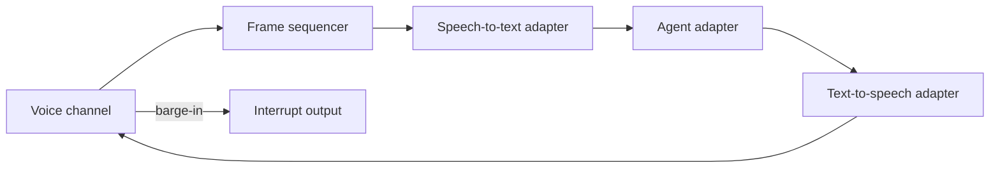

# Mistral Voice Agent Gateway

> A focused, provider-neutral reference for low-latency voice-agent streaming, bilingual responses, barge-in interruption, duplicate-frame handling, and bounded provider retries.



## Quickstart

```bash
make test
make eval
make demo
```

The demo requires no API key and makes no network request.

## What I built

- Ordered frame processing and replay protection.
- Barge-in that cancels active output.
- English and Arabic response paths.
- Bounded retry behavior with visible events.
- Ten evaluation scenarios across 30 trials.

## What is mocked

Speech, model, telephony, and messaging providers use deterministic local adapters. The demo stores no real audio, phone number, or vehicle/customer record.

## Known limitations

The reference evaluates gateway state and failure behavior; it does not claim production speech quality or carrier latency.

The gateway is intentionally smaller than a full upstream fork so reviewers can see the original integration work immediately. See [UPSTREAM.md](UPSTREAM.md), [SECURITY.md](SECURITY.md), and [PROVENANCE.md](PROVENANCE.md).
