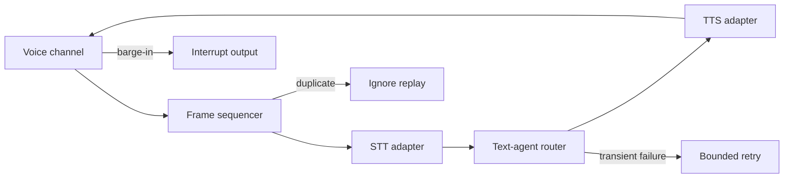
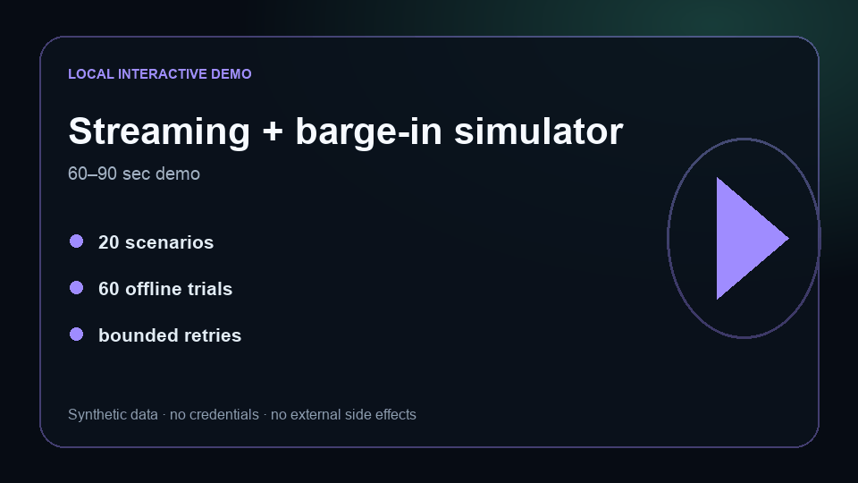

# Mistral Voice Agent Gateway

[](https://github.com/AbuElNour/mistral-voice-agent-gateway/actions/workflows/ci.yml)
[](https://github.com/AbuElNour/mistral-voice-agent-gateway/actions/workflows/codeql.yml)
[](LICENSE)

**Problem:** voice-agent gateways must handle ordered frames, language switching, interruptions, retries, duplicate delivery, and unsafe side effects—not just produce a spoken answer.
**Result:** this focused reference passes 60/60 deterministic orchestration trials across 20 scenarios while keeping speech, telephony, and messaging providers fully mocked.
**Architecture:** an ordered frame state machine connects STT, agent, and TTS seams; barge-in cancels active output, replayed frames are ignored, and provider retries are bounded.
**My contribution:** I isolated and implemented the original gateway behavior, bilingual state paths, interruption/replay controls, deterministic adapters, interactive simulator, regression tests, and two-provider routing evaluation harness.



## Five-minute quickstart

Python 3.11+ is the only requirement:

```bash
make test
make eval
make demo
make eval-live-validate
```

The default path makes no network request, stores no audio, and costs $0.

## Bilingual streaming and barge-in simulator

[](#run-the-browser-demo)

### Run the browser demo

```bash
python3 -m http.server 8080 -d demo
```

Open `http://127.0.0.1:8080`. Send English and Arabic frames, interrupt active output, and replay a duplicate sequence. The event panel exposes `frame.accepted`, `stt.completed`, `tts.started`, `speech.interrupted`, and `frame.duplicate`. The release video remains gated until the full release checks complete.

## Deterministic evaluations

| Gate | Current offline result |
|---|---:|
| Orchestration scenarios | 20 |
| Deterministic trials | 60 |
| Overall success | 100% |
| Interruption, replay, and retry success | 100% |
| Paid credentials in CI | 0 |

`make eval` regenerates `evals/results.json`. The evaluator covers streaming, Arabic response routing, barge-in, duplicate frames, and bounded provider retry behavior. Pull-request CI also validates the provider request/response contracts without contacting either API.

## Provider-backed routing evaluations

The live comparison deliberately evaluates **text-agent routing and orchestration**, not real STT/TTS quality. Twenty balanced tasks cover bilingual requests, adversarial transcripts, explicit confirmation, malformed frames, provider failures, recovery, duplicate handling, and leakage.

```bash
make eval-live PROVIDER=openai MODEL=gpt-5.6-terra TRIALS=5
make eval-live PROVIDER=mistral MODEL=mistral-small-2603 TRIALS=5
```

- OpenAI uses Responses with `store:false`, low reasoning effort, and strict function calling.
- Mistral uses forced function calling with a JSON-schema parameter contract.
- Keys are read only from `OPENAI_API_KEY` and `MISTRAL_API_KEY`.
- Requested and returned model IDs must match; automatic substitution is disabled.
- Per-trial traces remain under ignored `.local/evals/` and retain no audio, key, or hidden reasoning.
- The shared budget ledger stops requests before combined estimated spend exceeds USD 25.
- All failures and a blinded, stratified sample of passes are queued for rubric review.

No provider result is published yet because credentials were not present for this release-candidate build. Comparative claims require both providers, five trials per task, at least 85% pass@1, 100% deterministic safety success, and completed review.

## Security boundaries

| Boundary | Enforcement |
|---|---|
| Frame order | Monotonic sequence IDs; replayed IDs are ignored |
| Barge-in | A new caller frame cancels active output |
| Provider failure | At most two retries after the initial attempt |
| Side effects | External actions require an explicit confirmation event |
| Data | Synthetic UTF-8 phrases are processed in memory |
| Observability | Tool events, transitions, approvals, retries, and errors are retained |

Production authentication and signed webhook verification belong in provider adapters, never committed configuration. See [SECURITY.md](SECURITY.md).

## Failure analysis

**Observed regression:** language tags were case-sensitive, so a valid channel tag such as `AR-SA` took the English response path.
**Engineering improvement:** tags are normalized to their lowercase base language and `test_normalizes_arabic_language_tag` locks the bilingual behavior in CI.

The failure taxonomy distinguishes decode/malformed input, duplicate delivery, interruption failure, unsafe action, retry exhaustion, provider error, schema/parse error, and grader failure. Failed live trials are never discarded.

## What is mocked

STT, TTS, model, telephony, and messaging providers are deterministic local adapters. The repository contains no real audio, phone number, customer record, provider credential, or carrier configuration.

## Known limitations

- This reference evaluates gateway state and text routing, not production speech quality or carrier latency.
- It does not benchmark accents, noisy audio, acoustic echo, or real turn detection.
- Durable session storage and provider-specific channel authentication are integration seams.

The focused code is intentionally smaller than the upstream project so reviewers can see the original gateway work immediately. See [UPSTREAM.md](UPSTREAM.md) and [PROVENANCE.md](PROVENANCE.md).
